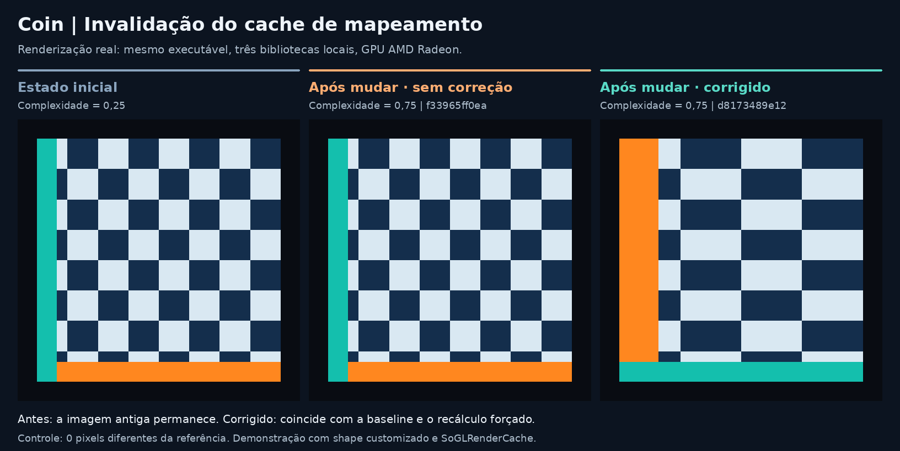

# Default texture mapping cache: local evidence

Code under review: `996d4601d9d0a867e3df79577e19c0bec104d3b3`.
Baseline: master plus #833, `44025052aea5aa6918a4035fbcb70dc67547e579`.
Earlier cache: `f33965ff0ea2c3bf7d6b5591693ea0f073d9c365`.

## Native Coin graphical reproduction



[Animation](comparacao.gif) · [Scene source](demo.cpp) · [Pixel verification](verification.json)

These are real `SoOffscreenRenderer` buffers from the same executable with
three Release libraries on AMD Radeon Graphics (radeonsi, renoir, ACO),
Mesa 25.2.8, compatibility OpenGL 4.6. The chart only adds labels to the buffers.

This deliberately controlled custom `SoFaceSet` uses inherited complexity to
change its bounds from 1×1 to 2×1 while drawing a unit quad. This is not a claim
that ordinary SoFaceSet bounds change with complexity. The default mapping
changes from S=Y, T=X to S=X/2, T=Y. An asymmetric checker shader exposes the
mapping returned by `SoTextureCoordinateBundle`.

The shape warms its bounds, records `SoGLRenderCache` beneath an empty cache
element level, and uses the cache's `isValid()` to choose replay or rebuild.
Initial complexity is 0.25; three unchanged renders follow; then complexity
becomes 0.75; a final forced invalidation supplies the recalculated reference.
The first repetition can rebuild due to texture-coordinate state setup; the
following two unchanged renders replay normally.

Before the dependency correction, the edited frame incorrectly replays the
old mapping. After it, `SoComplexityElement` invalidates the render cache.
The corrected frame is pixel-identical to both the baseline and forced fresh
references. The stale and corrected frames differ in 127,078 of 262,144 pixels.
Full renderer diagnostics are in `base.log`, `before.log`, and `fixed.log`.

To build on a Linux GLX machine with a Coin source and shared build available:

```sh
c++ -std=c++11 -O2 demo.cpp -I<coin-build>/include -I<coin-source>/include \
  -L<coin-build>/lib -lCoin -lGL -o demo
mkdir -p output
LD_LIBRARY_PATH=<coin-build>/lib COIN_GLXGLUE_NO_PBUFFERS=1 \
  COIN_GLX_PIXMAP_DIRECT_RENDERING=1 ./demo output/candidate
```

Repeat with the same executable, changing only the library directory and
output prefix. The program writes bottom-up Coin RGB buffers as top-down PPM.
PNG conversion preserves their pixels. A working X display is needed; Xvfb
with compatible GLX can be used for software rendering.

## Local validation

- Debug: 133/133; Release: 133/133; renderer OFF without DISPLAY: 119/119.
- Composition with #901 (`947fd82c076e`) and #902 (`a26b2816848c`): 227/227;
  composition commit `a641502ec607103aabb04caf332402827b710a6d`.
- No skipped tests. The two dependency regressions fail before the correction
  and pass after it; the CPU test also exposes the pre-existing core helper bug
  in the baseline, while the GL mapping test passes on that baseline.
- Raw CTest output is included in the corresponding `*-ctest.log` files.
- `abi.txt`: unsuppressed Debug abidiff against master+#833: zero removed or
  changed functions, 170 additions. `abi-before-fixed.txt` is empty (exit 0),
  comparing the previous cache with the corrected cache. Release symbols are
  recorded in `release-symbols.json`; no baseline symbols were removed.

## Timing and memory

`benchmark-threeway.json` retains every sample: same Release executable,
400 own-coordinate face shapes, 4096 points each, VBO, ten stable frames, a
coordinate edit, six runs per library and driver in all six library orders.
CPU sums process threads; wall includes `glFinish()`. llvmpipe used four
threads. All builds/compiler temporaries were in RAM; no builds or tests ran
concurrently with these measurements. This is local hardware evidence, not
a cross-platform performance guarantee.

| Process CPU, ms | Baseline | Corrected cache |
| --- | ---: | ---: |
| Radeon stable | 21.8465 | 2.6225 |
| Radeon invalidated | 26.1090 | 14.9000 |
| Radeon restabilized | 21.7215 | 2.7125 |
| llvmpipe stable | 91.7835 | 83.0000 |
| llvmpipe invalidated | 102.6430 | 100.8860 |
| llvmpipe restabilized | 91.1925 | 76.0860 |

Stable RSS baseline/cache: Radeon 117.5915/130.7360 MiB;
llvmpipe 231.9630/252.0040 MiB. Invalidated RSS:
Radeon 117.7695/130.8985 MiB; llvmpipe 251.6190/280.2170 MiB.
Memory includes the driver and allocator; it is not a live-cache or VRAM count.
Cache gains and extra memory versus baseline remain. Small timing differences
against the previous cache vary between rounds; this dependency correction
does not itself establish a performance improvement.

These are local Linux results; this evidence does not claim remote CI passed.
