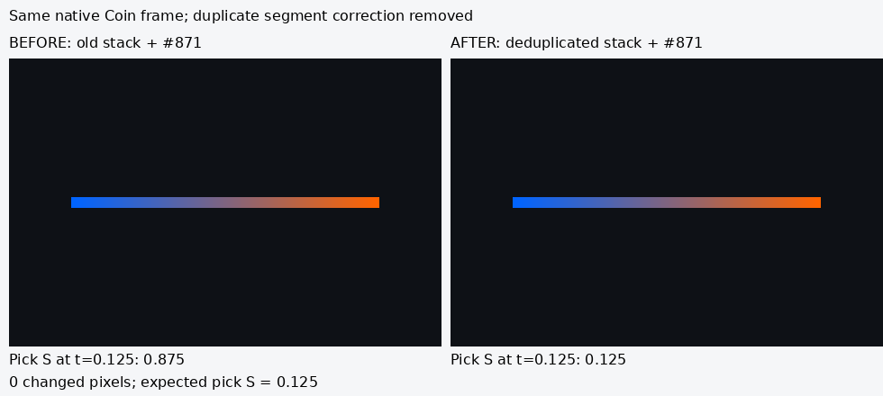

# Segment picking consolidated into upstream #871

The duplicate fork PR #26 is retired. Its three commits are removed from the active texture-coordinate stack; the four later themes are replayed directly over M09. The active stack has 23 themes and 52 commits, at 91be1a447e32f0fa93eef22b96db174ea8260182. B01 through M09 retain their exact reviewed heads. Upstream #871 (deccdcc8242997c0ff059e00754f6980f5882a9d), including its #864 dependency, is unchanged and owns the segment-attribute correction.

The original texture-only LIN fix preserved historical normal interpolation and material selection. #871 corrects the shared weights for all those attributes. Applying both unchanged swaps texture weights twice. For a segment with S=0 and S=1, a pick at t=0.125 incorrectly returns S=0.875; the deduplicated combination returns S=0.125.

Both frames are actual 480x320 RGB output from Coin SoOffscreenRenderer, legacy OpenGL under Xvfb/Mesa llvmpipe. Same executable, byte-identical exported scene, different loaded libCoin. No CoinRender, custom GL geometry, generated artwork or pixel retouching. The frames have zero different pixels; this correction affects the CPU picking coordinates. Debug -O0 -g0, threads and legacy GL enabled, EGL disabled; LIBGL_ALWAYS_SOFTWARE=1, COIN_GLXGLUE_NO_PBUFFERS=1, COIN_GLX_PIXMAP_DIRECT_RENDERING=1, COIN_VBO=1, COIN_VBO_MIN_LIMIT=20.

## Results

- Old texture stack b9de21a5b6d + exact upstream #871 changes: SegmentPickWeights_texture fails; the other eight segment/normal CTests pass. This reproduces the double inversion.
- New texture stack alone: 241/241 complete CTests, 52/52 CPU without DISPLAY, no skips. Its segment callback matches master byte for byte; it no longer contains a competing segment fix.
- New texture stack + exact upstream #871/#864 changes: 9/9 segment/normal CTests without DISPLAY and 250/250 complete CTests, no skips.
- CUBE, SPH, ANA and VRML: each new exact parent reproduces the theme's failure, each new head passes all selected regressions.
- No exported-symbol additions/removals between the old and deduplicated integration libraries. No public-header changes and no CoinRender dependency.

The combined profile intentionally uses #864's inverse-transpose normalized world normals and #871's corrected segment normal/texture/material weights. Three historical test files contain expectations for the earlier contract; integration-test-oracles.patch changes those exact assertions only in the disposable combined profile. No tests are excluded. The published thematic test sources remain unchanged. This is an explicit integration profile, not a claim that #871 preserves the old normal/material values.

## Reproduction

Archive b9de21a5b6d8fdef9455c19e65557740102c1f7f for the failing integration and 91be1a447e32f0fa93eef22b96db174ea8260182 for the corrected one. Apply git diff 31a4ea1bbd1974616e6e25a9f3c2adf0de8bb642..deccdcc8242997c0ff059e00754f6980f5882a9d to each disposable source tree. For the combined full suite, apply integration-test-oracles.patch to the corrected source's tests only. Configure both with the same options above; run ctest -R '^(SegmentPickWeights_|PickedPointNormal_)' without DISPLAY and the complete suite under Xvfb. The standalone suite uses the unmodified new texture-stack source.

Compile scenes.cpp against the standalone headers and libCoin using g++ -std=c++11 -O0 -g0, and run its line-picking scene with each integration library selected through LD_LIBRARY_PATH. PNGs are lossless conversions of its original PPM frames. All disposable builds and executables are confined to a task-exclusive RAM directory. validation.json contains the pinned inputs and measured results.
