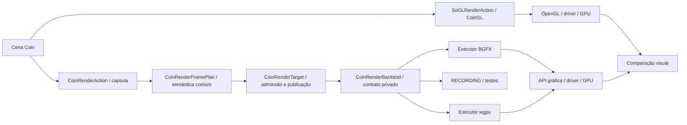

# CoinRender: arquitetura e fonte de verdade

## Acompanhamento da cobertura

A [matriz consolidada de recursos e combinações](coin-render-feature-matrix.md), iniciada em 16/10/2026, é o ponto de entrada para o estado funcional atual e suas evidências. Os relatórios e contagens datados abaixo conservam seus escopos históricos; não são uma nova execução no HEAD atual.

Estado auditado em 2026-10-12 na branch `codex/coin-render`. Este documento
descreve a intenção atual da funcionalidade; os relatórios de validação e as
ADRs de ondas anteriores preservam o contexto histórico de cada entrega.

## Propósito

A API pública fica em `include/Inventor`, mas continua experimental: `COIN_BUILD_RENDER=ON` constrói a biblioteca separada `CoinRender`, e somente `COIN_INSTALL_RENDER_EXPERIMENTAL=ON` instala seus headers e pacotes. A instalação padrão de Coin exclui esses 17 headers, apesar de estarem junto aos demais headers públicos.

CoinRender amplia as opções de renderização do Coin além do CoinGL. Ele captura
a semântica da cena Coin uma vez em um plano comum e a entrega a executores
como BGFX e wgpu. Um futuro executor deve consumir o mesmo contrato sem criar
outra interpretação da cena na action. A semântica dos nós, o modelo visual
escolhido e controles matemáticos independentes definem o resultado esperado;
CoinGL continua sendo a referência de compatibilidade histórica para entradas
válidas, respeitada a [política de compatibilidade](coin-render-compatibility-policy.md).

O executor CPU/`RECORDING` é auxiliar: fornece log e renderização em software
para testes sem GPU e para diagnósticos de contratos. Ele não chama CoinGL,
não é o oráculo de paridade visual e não corrige a saída BGFX/wgpu. Alguns
testes o instanciam mesmo em builds GPU; a presença do objeto na biblioteca
não o torna o executor selecionado para esses builds.

## Fluxo e donos

| Decisão | Dono no projeto |
| --- | --- |
| Travessia Coin, callbacks e leitura de estado | `CoinRenderAction` e builder comuns |
| Significado de geometria, materiais, texturas, composição, profundidade e limites | Contratos e Core `coinrender` |
| Buffers, shaders, recursos, passes, apresentação e readback | Executor BGFX ou wgpu |
| API gráfica, fragmentos cobertos pelo rasterizador fixo e implementação de driver | API/driver/GPU, salvo política própria implementada no executor |
| Resultado esperado | Semântica Coin, modelo visual e expectativa independente para a propriedade testada |
| Compatibilidade visual histórica do Coin válido | CoinGL no mesmo ambiente, com divergências classificadas |
| Log e rasterização sem GPU | `RECORDING`/CPU auxiliar |

BGFX e wgpu são alternativas, não camadas uma sobre a outra. OpenGL, Vulkan,
D3D12 e Metal são APIs usadas por um executor e pelo driver; escolher OpenGL
em BGFX/wgpu não transforma esse caminho no CoinGL legado.

## Seleção atual e extensão futura

`COIN_RENDER_BACKEND` escolhe **um executor por build**: `BGFX`, `RUST_BRIDGE`
(wgpu), os protótipos `DAWN`/`WGPU_NATIVE` ou `RECORDING`. O
`CoinRenderBackendFactory` liga explicitamente esse executor ao target. Dentro
do executor GPU, `CoinRenderOptions` pode selecionar uma API gráfica suportada
sem fallback silencioso. A interface comum permite novos executores; carregá-los
dinamicamente ou alternar BGFX e wgpu no mesmo binário ainda não está
implementado e não deve ser anunciado como capacidade existente.

Uma nova modalidade Coin começa por contrato comum e expectativa de
compatibilidade, depois é implementada ou rejeitada explicitamente em cada
executor qualificado. Uma diferença que só aparece entre drivers não fica
resolvida ao mudar o backend CPU ou ao relaxar um gate de imagem. O
[caso de cobertura AMD/NVIDIA](</home/dikluwe/Área de trabalho/Estudo coin/consolidacao-frentes-20261016/renderer-history/docs/validation/perspective-coverage-20261012/summary.md>)
permanece aberto para os caminhos GPU: o próprio CoinGL escolheu lados
diferentes de uma aresta entre as duas placas, e o modo 3× regrediu outras
cenas. É preciso definir uma política de cobertura portátil e demonstrá-la em
BGFX e wgpu antes de prometer pixels idênticos entre placas.

## Estado e documentos

A [checklist das próximas frentes](coin-render-next-fronts-checklist.md) é a
fonte de verdade para itens abertos e concluídos no escopo declarado de cada
linha. O [plano P/F/A](coin-render-work-plan.md) preserva a decomposição e as
dependências históricas; um P ainda aberto ali pode ter subperfis já fechados
na checklist. Os [relatórios de isolamento](coin-render-isolation-roadmap.md)
registram a separação de camadas já executada. O
[guia da branch](coin-render-branch-guide.md) aponta o checkout de integração
e os passos para um PR.

Na revisão desta arquitetura, a checklist tem **88 caixas concluídas e 25
abertas**: 20 frentes e cinco critérios repetidos a cada entrega. Das frentes,
`Remover completamente os fontes/referências GL remanescentes do Coin base` é
trabalho do Coin base, e `Qualificar CoinGL nativo com oito mapas` é trabalho
do oráculo CoinGL. Ambos continuam listados como dependências visíveis; sua
conclusão não deve ser atribuída ao executor BGFX ou wgpu. Mesa, drivers,
Android físico e hardware ausente exigem evidência externa ao código comum.
