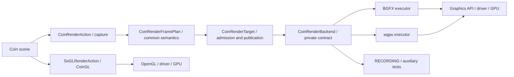

# CoinRender architecture and ownership

CoinRender extends Coin rendering beyond CoinGL. `CoinRenderAction` captures scene
semantics once into a common plan. Each executor consumes that contract rather
than independently interpreting Coin nodes. Scene semantics, the chosen visual
model and independent mathematical controls define the expected result;
CoinGL, Coin's current OpenGL renderer, provides compatibility evidence for valid inputs under the
[compatibility policy](coin-render-compatibility-policy.md).

The public declarations live under `include/Inventor`, but remain experimental:
`COIN_BUILD_RENDER=ON` builds the separate `CoinRender` library;
`COIN_INSTALL_RENDER_EXPERIMENTAL=ON` installs its headers and packages. The
default Coin installation excludes CoinRender experimental headers.
Their source location does not make them stable Coin API.

| Decision | Owner |
| --- | --- |
| Coin traversal, callbacks and state reads | Common action and builder (Wiring) |
| Geometry, materials, texture semantics, composition, depth and limits | `coinrender` contracts and Core |
| Buffers, shaders, resources, passes, presentation and readback | BGFX or wgpu executor (Infra) |
| Fixed raster coverage and driver implementation | Graphics API/driver/GPU unless the executor implements an explicit portable policy |
| Expected result | Coin semantics, visual model and independent control for the tested property |
| Visual compatibility with the current Coin renderer | CoinGL in the same environment, with classified divergences |
| Headless diagnostic log and software rasterization | Auxiliary RECORDING/CPU |

RECORDING does not call CoinGL, is not the visual parity oracle and does not
repair BGFX/wgpu output. Tests may instantiate it in GPU builds; that does not
make it the selected executor for those builds. BGFX and wgpu are alternatives.
OpenGL, Vulkan, D3D12 and Metal are graphics APIs used by an executor. Selecting
OpenGL inside BGFX/wgpu does not select CoinGL's current rendering traversal.

`COIN_RENDER_BACKEND` selects one executor per build: `BGFX`, `RUST_BRIDGE`
(wgpu), or `RECORDING`. The private
`CoinRenderBackendFactory` wires that executor and its runtime into the target.
`CoinRenderOptions` may request a supported graphics API within the compiled
GPU executor, without silent fallback. Dynamic executor loading and switching
BGFX/wgpu in one binary are not implemented.

A new Coin modality starts with a common semantic contract and compatibility
expectation, then is implemented or explicitly rejected by each executor.
Changes to the CPU helper or relaxed image gates do not resolve GPU differences.
The historical AMD/NVIDIA perspective-coverage study observed different edge
choices even in CoinGL; a 3× mode regressed other scenes. Its receipts remain
[archived](coin-render-evidence.md). Do not infer universal cross-GPU pixel
identity from a local image comparison. Native numeric differences require the
case-specific diagnosis described in the compatibility policy.

The [scope matrix](coin-render-feature-matrix.md) identifies open qualification
work, including B34/B94/B95. Historical checklist counts and campaign completion
claims remain in the companion archive with their original dates and scopes.
