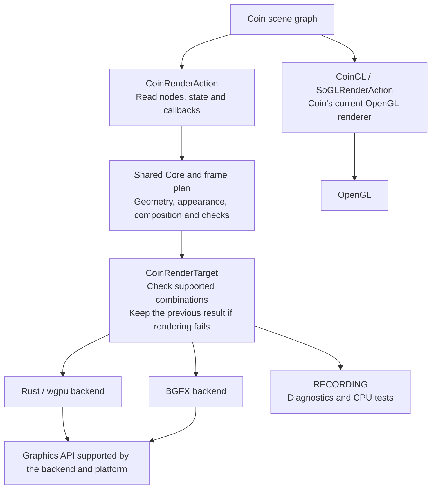

# Proposal: an optional rendering path for Coin, introduced in stages

I would like to discuss CoinRender, an experimental, optional rendering library
alongside the existing `SoGLRenderAction` renderer, called **CoinGL** below.
CoinGL remains Coin's current OpenGL renderer.

The implementation was developed with AI assistance. I am responsible for the
contribution, its verification and addressing review feedback. I am sharing the
design and its costs for discussion; I am not asking for CoinRender review ahead
of the existing PR queue.

## Motivation

I want to explore additional graphics APIs while retaining Coin scene graphs and
application-side scene construction. Concrete motivations include Apple's
[deprecation of OpenGL on macOS](https://developer.apple.com/library/archive/documentation/GraphicsImaging/Conceptual/OpenGL-MacProgGuide/opengl_intro/opengl_intro.html),
the needs of applications using Coin such as
[FreeCAD](https://github.com/FreeCAD/FreeCAD/blob/main/cMake/FreeCAD_Helpers/SetupCoin3D.cmake),
and Android/browser environments that use GLES or web graphics APIs rather than
the desktop OpenGL interface. These are motivations, not claims that all of those
platforms or applications are qualified by this implementation.

FreeCAD helped motivate and exercise the work. Its application patches, macros
and Quarter integration harness are outside the proposed Coin contribution.

## Architecture

`CoinRenderAction` reads the scene into a common frame plan. The shared Core
processes captured data without traversing nodes or calling a GPU API. Each
backend converts that plan into its own buffers, shaders and rendering passes.
The target checks whether the requested feature combination is supported and
reports an error otherwise. Failed submissions preserve the previously published
result according to the target's rendering contract.

The target also tracks resource ownership and recreation so that cached resources
from a destroyed or resized target cannot be reused as though they were current.
Application windows remain owned by the application.

One backend is selected per build. Within a GPU backend, API selection depends
on implementation and platform support. Selecting OpenGL through CoinRender uses
the common frame plan; selecting CoinGL uses its existing traversal. RECORDING
provides diagnostic and CPU controls, not proof of GPU image parity.

## Functionality in the prototype

| Area | Summary |
| --- | --- |
| Scene rendering | Geometry and bindings, draw styles, materials, lighting, fog, clipping, depth, viewports and bitmap content |
| Textures and composition | Multitexture, projective coordinates, linear/sRGB spatial textures, RTT, transparency, shadows, bump mapping and selected antialiasing profiles |
| Managers and lifecycle | Technical display modes, layers, stereo composition, selection highlights, multiple targets, readback and recovery |
| Performance | Plan reuse, camera/geometry updates, interning, batching, instancing and resource caches |

Each mechanism has explicit limits on input sizes, memory or supported
combinations. The [full functionality and limitations](coin-render-feature-matrix.md)
are documented separately. This is not a claim of universal compatibility with
all Coin scenes, graphics APIs or platforms.

## Build, ABI and maintenance cost

CoinRender is a substantial optional addition. The current renderer directories
contain approximately **62,000 lines** of first-party source/shaders, with another
**6,000 lines** in the action implementation and approximately **141,000 lines** of
renderer tests and support code. These are tracked text-line counts, including
comments and blank lines, excluding vendored dependencies, documentation and
examples. The [source-size breakdown](coin-render-size.md) identifies the
responsibilities and the cleanup already performed. The proposed first PR would
contain a smaller subset of the shared features, not the complete common layer.

| Build configuration | Additional requirements |
| --- | --- |
| CoinRender disabled, the default | No new Rust or BGFX dependency from CoinRender |
| Core / RECORDING | C++17 compiler for the implementation; public consumers retain C++11 |
| Rust/wgpu | C++17 plus Rust and Cargo; wgpu 24 and its dependency graph, resolved through the checked-in `Cargo.lock` |
| BGFX | C++17 plus a separately built BGFX SDK with bx, bimg and `shaderc`, using pinned revisions and an installed CMake package |

CMake invokes Cargo with `--locked` for the wgpu build. Most crates come from
crates.io; modified Naga, wgpu-hal, wgpu-core and glow sources are vendored and
selected through Cargo path overrides. Coin CMake consumes a prepared BGFX SDK;
it does not download BGFX or apply its patches automatically.

There are real dependency-maintenance obligations: the BGFX patches cover EGL
swap interval handling, D3D12 device-removal cleanup, completed-frame presentation
flags and an optional Vulkan sample-interpolation extension. The Rust dependency
changes include shader lowering and device/context, synchronization and teardown
handling. These changes are documented in the
[dependency patch guide](../cmake/patches/README.md). They are not all upstream
fixes; they need separate review, upstreaming where appropriate, or an explicit
plan to maintain them before the affected profiles can be contributed.

**Coin 4 ABI compatibility is not established.** In particular, the current
prototype adds `SoBumpMapElement::source`, changing a public class's layout. I am
treating that as an ABI-breaking change for Coin 4 and would redesign it before
proposing a Coin 4-compatible integration. A separate optional library does not
by itself make changes to existing Coin classes ABI-safe.

The experimental CoinRender API and its paired private C++/Rust transport are
also not proposed as stable interfaces.

## CI and validation

The fork currently adds a hosted Ubuntu Rust/wgpu build-and-test job using Mesa
and Xvfb. A separate, manually triggered BGFX workflow targets physical GPU
runners with a preinstalled SDK. Those workflow definitions do not establish a
passing upstream CI run or physical GPU coverage for hosted jobs.

For upstream, I propose starting with dependency-free Core/RECORDING tests and a
C++11 consumer compile check. Backend jobs would accompany their respective PRs;
physical GPU qualification would remain separate from software-rendered CI.

The latest focused verification passed 50 CPU/contract CTests and eight Rust
shader checks; the C++11 consumer and the wgpu production library also compiled.
The production binary was checked to exclude the auxiliary CPU rasterizer.
**The consolidated revision still needs fresh GPU qualification.** Earlier Linux
and Windows GPU results apply to their
recorded revisions and environments, not automatically to this revision.

Before requesting implementation review, I plan to complete and report tests
on the frozen source revision, including Windows DirectX 12, Vulkan and OpenGL.
The report needs actual rendered-image checks, presentation, resize, readback and
recovery results, with the GPU, driver and dependency versions identified. No
result is claimed here for a test that has not run.

Outstanding work also includes native surface teardown, Vulkan recovery/stale
presentation cases, broader Android/macOS/Wayland coverage, and durable external
publication of the archived validation material.

## Proposed contribution sequence

I propose the following sequence, after the current PR queue has advanced:

1. **Prerequisites:** submit independent Coin corrections separately and resolve
   changes to existing Coin classes, especially the Coin 4 ABI issue above.
2. **PR 1 — shared Core, frame plan and RECORDING:** introduce the optional
   library, common behavior and CPU tests without Rust or BGFX dependencies.
3. **PR 2 — Rust/wgpu backend:** add its build integration, private transport,
   dependency changes, focused CI and revision-specific GPU results.
4. **PR 3 — BGFX backend:** add its SDK integration, reviewed dependency patches,
   focused CI and revision-specific GPU results.

Each stage may need several smaller PRs. I would prepare those slices rather
than ask maintainers to review the complete prototype at once. FreeCAD/Quarter
adaptations and large validation artifacts would remain outside the series.

Would this direction and contribution sequence be suitable for Coin? The main
questions are whether the shared-plan design and optional backend dependencies
fit the project, and whether this staged starting point is acceptable once the
existing PRs and the validation/ABI prerequisites have progressed.
