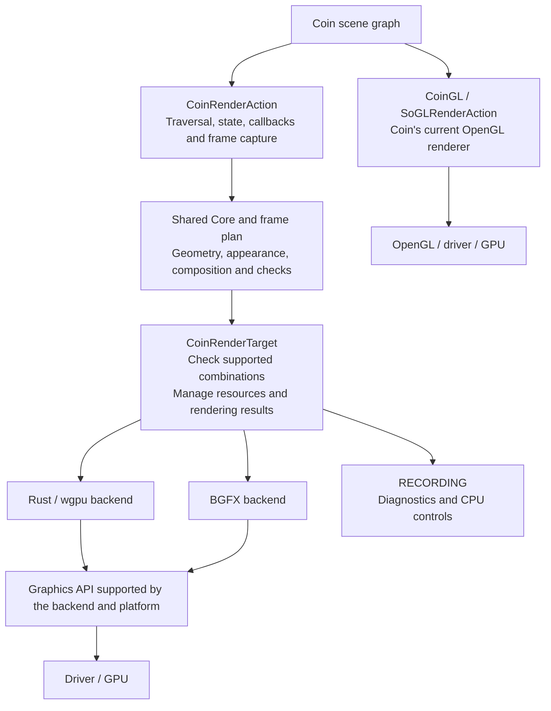

# CoinRender experiment: optional BGFX and wgpu rendering backends for Coin — feedback welcome

> Issue draft for discussion. The source branch is published separately; this
> document does not create or publish a GitHub issue.

I have been experimenting with an optional rendering path for Coin. It captures
a frame description during normal Coin traversal and renders it with BGFX or
Rust/wgpu backends. I would like to share what has been implemented and ask
whether this direction could be useful to the project.

A brief overview of the current prototype:

- **Source:** [Dikluwe/coin, branch `coin-render`](https://github.com/Dikluwe/coin/tree/coin-render).
- **Opt-in:** disabled by default (`COIN_BUILD_RENDER=OFF`).
- **Toolchains:** C++11 for public API consumers, C++17 for the implementation;
  Rust and Cargo are required only for the wgpu backend.
- **Dependencies:** BGFX with bx, bimg and shaderc, or wgpu 24 through Cargo's
  lockfile. The prototype includes external BGFX patches and modified vendored
  Naga, wgpu-hal, wgpu-core and glow sources. These changes need their own review
  and maintenance plan; they are detailed in the
  [dependency guide](https://github.com/Dikluwe/coin/blob/coin-render/cmake/patches/README.md).
- **Size:** approximately 68,000 first-party source/shader lines across capture,
  shared code and both backends, plus 141,000 test/support lines. Counts include
  comments and blank lines and exclude vendored dependencies.
- **Coin 4 ABI:** not established. The prototype adds `SoBumpMapElement::source`
  to an existing class; I am treating this layout change as ABI-breaking for
  Coin 4 and would redesign it before proposing a compatible integration.
- **GPU validation:** earlier results cover specific Linux/Windows revisions;
  the consolidated revision still needs fresh GPU qualification, including
  Windows DirectX 12, Vulkan and OpenGL. CPU/shader checks are not GPU results.

## How it works

The existing `SoGLRenderAction` renderer, called **CoinGL** below, remains Coin's
current OpenGL renderer.

The capture reads Coin nodes and state into a frame description; it does not
introduce a second application scene graph. Shared code prepares geometry,
appearance and composition rules without calling a GPU API. Each backend then
creates its own buffers, shaders and passes and handles presentation/readback.
The target rejects unsupported combinations and preserves the previous result
when a submission fails according to its rendering contract. Application windows
remain owned by the application.

One backend is selected per build. Selecting OpenGL within CoinRender still uses
the frame-plan path. RECORDING is a CPU/diagnostic control, not evidence that a
GPU backend renders correctly.

## What is implemented

| Area | Summary |
| --- | --- |
| Scene rendering | Geometry and bindings, draw styles, materials, lighting, fog, clipping, depth, viewports and bitmap content |
| Textures and composition | Multitexture, projective coordinates, spatial textures, RTT, transparency, shadows, bump mapping and selected antialiasing profiles |
| Managers and lifecycle | Technical display modes, layers, stereo composition, selection highlights, multiple targets, readback and recovery |
| Performance | Plan reuse, camera/geometry updates, interning, batching, instancing and resource caches |

Each feature has specific limits and supported combinations. The
[full scope and limitations](https://github.com/Dikluwe/coin/blob/coin-render/docs/coin-render-feature-matrix.md),
[architecture](https://github.com/Dikluwe/coin/blob/coin-render/docs/coin-render-architecture.md)
and [source-size breakdown](https://github.com/Dikluwe/coin/blob/coin-render/docs/coin-render-size.md)
provide the detail. Common code and capture alone account for about 33,000 lines;
a small initial contribution would need a narrower feature scope, rather than
simply moving all of that code into one PR.

## Validation and contribution scope

The latest focused checks passed 50 CPU/contract CTests and eight Rust shader
tests; the C++11 consumer and wgpu production library compiled. These checks do
not replace fresh GPU qualification of the consolidated revision. Native surface
teardown, Vulkan recovery/stale presentation, broader platform coverage and the
Coin 4 ABI issue above remain open.

The fork contains a hosted Ubuntu Rust/wgpu job using Mesa/Xvfb and a separate
manual BGFX workflow for physical GPU runners. These are workflow definitions,
not a claim of a green upstream pipeline or complete hardware coverage.

FreeCAD motivated and exercised some of the work. Its application patches,
macros and Quarter integration are excluded from this contribution. Large dated
validation artifacts remain outside the branch and still need durable external
publication, as described in the
[evidence guide](https://github.com/Dikluwe/coin/blob/coin-render/docs/coin-render-evidence.md).

The implementation was developed with AI assistance. I am responsible for the
contribution, its verification and addressing review feedback.

I am not asking for CoinRender review ahead of the current PR queue; I would
like to understand whether this work, or a smaller part of it, is worth pursuing
as a contribution once those PRs have progressed.

Does this direction seem useful to Coin? Are there existing plans or alternative
approaches I should consider before taking the work further?
