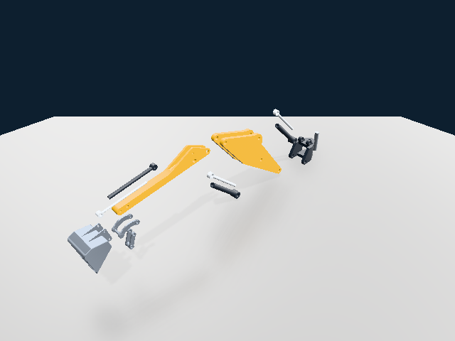

# Consolidação do PBR com captura retida opcional — 29/10/2026

`codex/pbr-clean` foi avançada de `ce72805f0536f8f0ef07dc5575d301b3ddffa507`
para `f8efe7752be0ae0740c2b8abe0e2bd410fa8587d`. O padrão continua sendo captura
convencional; `captureMode=COIN_RENDER_CAPTURE_RETAINED` habilita a alternativa.
O ponto de recuperação da integração modular é `2328b76807`.

Os shaders e executores PBR completos foram preservados. O adaptador conecta a
captura, o plano nativo e as atualizações incrementais ao executor existente.
Aliases de caster compartilham os mesmos índices e vértices. Mudanças de plano
reconstroem o transporte na ordem nativa; geometria PBR pode exigir novas
tangentes/transporte. O perfil é opaco, síncrono e de raiz inteira. Consulte
`docs/pbr/retained-capture.md` na branch PBR para responsabilidades e limites.

## Resultado

- 42/42 testes dirigidos: 468 buffers RGBA/profundidade exatos entre os caminhos.
- Ciclo de vida de janela Vulkan, resize, suspensão e perda de dispositivo: PASS nos dois modos.
- 14 cenas de superfícies: 28 buffers exatos contra convencional e SDK anterior imutável; outros 18 buffers incrementais e controles de admissão: PASS.
- O código de 114 arquivos da referência (backend, shaders e ambiente) corresponde à base fixada.
- AssemblyExample exportado: mesma cena e câmera, 640×480, IBL, PCF e chão com reflexão rugosa: cor e profundidade idênticas. PNGs possuem metadados diferentes; pixels decodificados são idênticos.
- Instalação completa e consumidor externo com apenas API pública: PASS nos dois modos.

O piso exportado foi removido de uma cópia para usar o chão gerado igualmente
nos dois caminhos. `assembly/scene.iv` preserva os corpos CAD dessa comparação;
os manifests guardam as matrizes. O orçamento CPU de reflexão foi aumentado
explicitamente de 128 para 512 MiB após a recusa normal de admissão da cena.
Esse limite não representa o consumo de memória. O teste usa a exportação
FreeCAD existente e o viewer, sem afirmar nova execução dentro da viewport
FreeCAD. Não houve campanha nova Android/wgpu nem medição de ganho de FPS.

`receipt.json` contém hashes dos binários, SDK BGFX, ambiente, referência e cena.
Os logs e JUnit completos ficam ao lado. `installed-consumer` contém o consumidor
compilado/ligado contra o prefixo instalado, sem headers privados.

