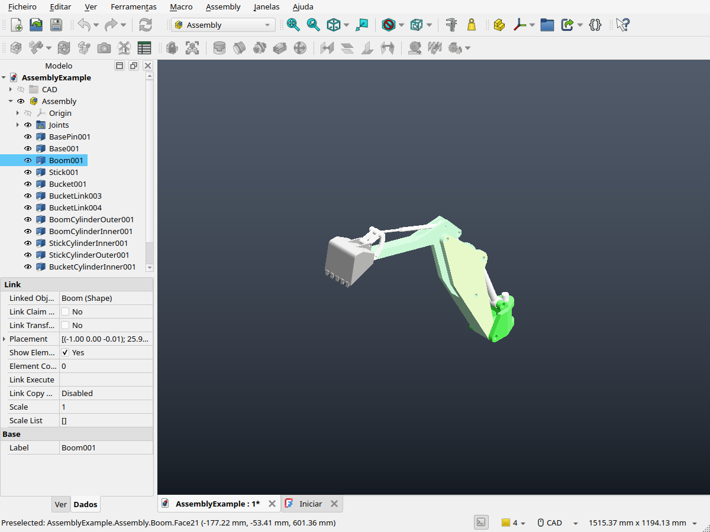
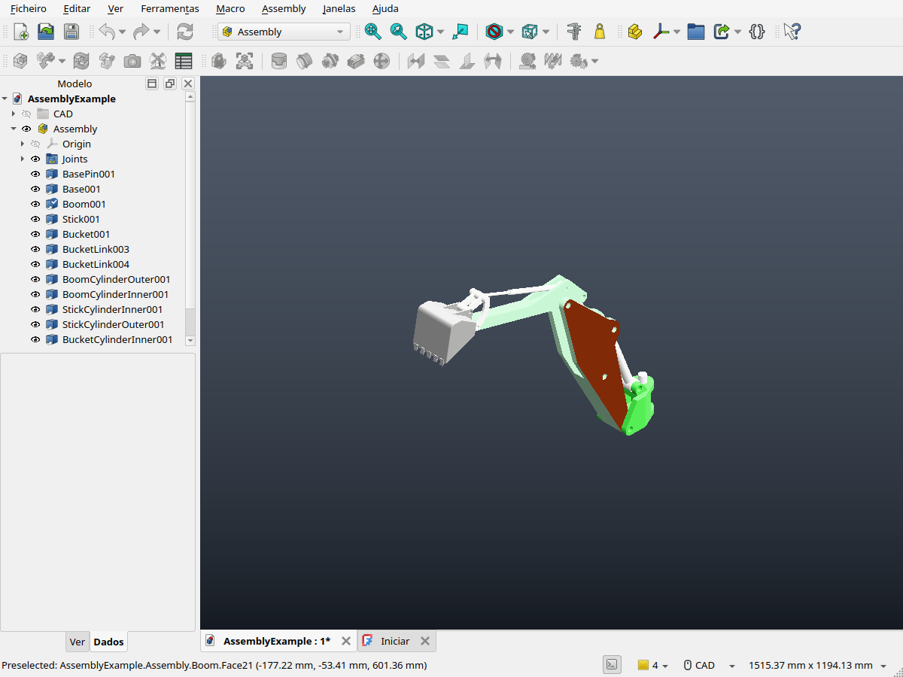

# PBR por face e seleção na viewport FreeCAD — 29/10/2026

Implementação: `5aa6125037` em `codex/pbr-clean`, sobre `f8efe7752b`.
O caminho convencional continua sendo o padrão. A apresentação PBR é opcional;
a captura retida exige `capture_mode="retained"` ou COIN_VIEWPORT_CAPTURE=retained.
O contrato está em docs/pbr/freecad-face-materials.md na branch de implementação.

## Qualificação

- 43/43 CTests dirigidos, sem falhas ou skips.
- FreeCAD real, Qt6/Pivy, AssemblyExample, janela nativa BGFX/Vulkan sob Xvfb.
- 13 peças e 288 faces CAD preservadas por segmentos OCC completos/disjuntos.
- Hover/clique em Boom.Face21: uma face. Seleção de Boom inteiro: 31 faces.
- Edição persistente por face, movimento e restauração; save/reopen de uma cópia FCStd: PASS.
- Nove quadros, mesma cena/câmera/resolução 934×736: 18 buffers RGBA/profundidade idênticos entre convencional e retido.
- Captura retida: 1 captura, 1 plano, 1 transporte e 61.086 vértices copiados inicialmente; nenhum aumento nesses contadores durante a interação.
- A edição/seleção mudou 7.236 pixels da face. Profundidade permaneceu intacta e limpar seleção restaurou a aparência original exatamente.
- A viewport nativa registrou zero readbacks, zero pixels Qt e zero chamadas auditadas ao renderer legado.
- Segundo attach nativo sem escolher captura: convencional, PASS. Escape/close restaura Coin/GL.
- Pacote inválido: recusa sem publicação nem mutação parcial, seguida de retry idêntico: PASS.
- Worker instalado: dois modos, quatro buffers exatos contra o build: PASS.

O destaque usa o canal emissivo existente, sobre estado transitório, sem alterar
os materiais do documento. Não há geometria extra de overlay nem outra captura
ou planejamento. Contornos, x-ray e arestas/vértices permanecem fora do perfil.
Os fatores PBR são por face; imagens são herdadas da peça. Topologia mutável e
outras plataformas não foram qualificadas; não se afirma ganho de FPS/memória.
O log FreeCAD contém um aviso de AddonManager/defusedxml, sem falha da campanha.

`receipt.json` registra hashes, dados do driver, resultados e limites.
Os diretórios native/default-native preservam importações, contagens e pacotes.
`authored.FCStd` é apenas a cópia de teste com o material salvo; o original não
foi sobrescrito. Os PNGs *-viewport vêm dos buffers do replay exato; os demais
PNGs são capturas da janela real FreeCAD. Buffers binários brutos e SDKs não
integram o commit de evidências.

