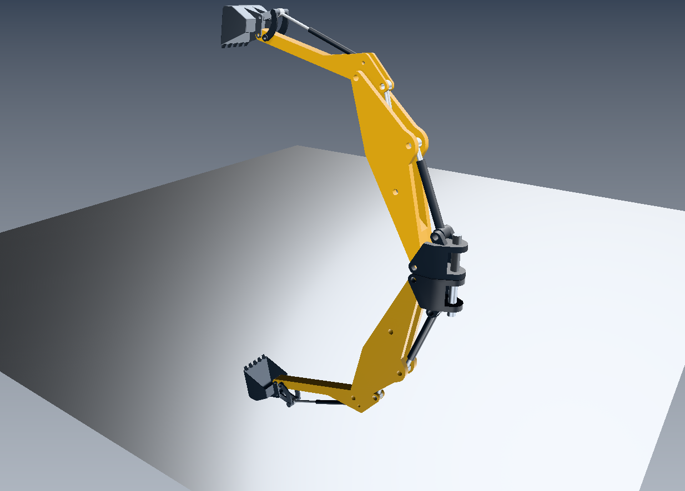

# C19: smooth planar PBR reflection, 2026-10-29

Local branch `codex/coinrender-retained-integration`; pinned PBR source
`ce72805f0536f8f0ef07dc5575d301b3ddffa507`. BGFX/Vulkan, native Xlib FreeCAD
viewport. Source/binary/environment/CAD hashes are in [provenance.json](provenance.json).
No CAD document was saved or modified by the preview.

The [disabled control](reflection-off.png) uses the same camera, polished floor,
materials, lighting, shadows and SSAO. The [default half-resolution result](reflection-on.png)
uses fewer reflection attachments. [Selection](selected.png) and [movement](moved.png)
were exercised on `BucketLink2`; C18 mesh validation remains enabled.

## Architecture and scope

The auxiliary GPU view consumes the existing retained VBO/IBO and draw order.
Only draw metadata is derived for the reflected camera, world clipping, light
vectors and tangent parity. There is no child target, second scene traversal,
second capture, composition classification or semantic planning pass. World
shadows and IBL textures are shared. Reflected SSAO is disabled because main-view
depth does not represent the mirrored view; main-view SSAO remains active.

One smooth isotropic planar receiver is supported. Rough/normal-mapped receivers,
multiple cameras/layers, missing receivers, exhausted clip slots and invalid or
excessive resource requests are refused. Rough reflection filtering, probes,
recursive mirrors, transparent PBR and wgpu/native GL execution remain future work.
C19 stays in application/executor code. Separately, candidate F8 initializes
native `SoRenderParams::clearColor` to transparent black, fixing two external-plan
regressions exposed by the changed stack layout. Its identity matrix defaults
and clear color have Coin-only coverage.

## Results

- [20 regression tests](tests.log), all passed; [XML](tests.xml) and
  [detailed output](tests-detailed.log). Includes native PBR defaults, material/IBL,
  anisotropy, effects, reflection, connector/no-borrow, BGFX core/instancing and mesh export.
- Independent reflected-geometry oracle: **1723 pixels exactly equal**, maximum
  channel error zero, main depth unchanged, below-plane geometry clipped,
  **zero additional composition classifications**. Scale/budget failures, retry,
  rough/missing receivers and tilted/offset-plane math also pass.
- [Nine FreeCAD GUI stages](results.json): reflection on/off, quarter/full
  resolution, restoration, selection, movement, interaction restoration and static repaint.
- [20 exact offscreen RGBA/depth comparisons](comparison.json) between retained
  and callback paths. All nine native OS snapshots also exactly match their
  offscreen controls in this campaign. Snapshots are test-only OS captures;
  production native presentation has **zero pixel readbacks and zero Qt image bytes**.
- [15 native reuse/admission/retirement checks](native-cache.json), with reflection enabled.
- [Pinned-source anisotropy controls](source-comparison.json): 14 fixtures,
  28 exact RGBA/depth buffers and 18 incremental-update buffers.
- [Boundary audit](boundary-audit.json): PASS, 201 classified paths, 64 native-boundary paths.

[Counter extract](counters.json): toggling reflection and changing its resolution
retain **one capture, one plan, one transport and 184278 copied vertices**.
Selection and movement also retain these counts. Combined interaction restoration
performs the existing conservative recapture (cumulative counts two). The last
forced static repaint reuses committed HDR: reflection passes remain seven and
shaded frames remain eight. Environment upload and anisotropy preparation remain one.
C18 reports 13 mesh builds, 15 tessellation attempts, with repaired closed `BucketLink2`.

At viewport 1234×886 the reflection uses RGBA16F + D24S8:

| Scale | Dimensions | Attachment bytes | MiB |
| --- | --- | --- | --- |
| 1 | 1234×886 | 13119888 | 12.51 |
| 2 (default) | 617×443 | 3279972 | 3.13 |
| 4 | 309×222 | 823176 | 0.79 |

Replacement admission includes resident and candidate attachments. Reflection
draw metadata has a separate 16 MiB logical bound. These are resource footprints,
not whole-process memory measurements or FPS claims. A content/camera change
conservatively redraws the additional reflected GPU pass.

## Reproduction

Run from the checkout, using the qualified BGFX build in `/tmp/coin-retained-bgfx`.
Run GPU campaigns sequentially. [commands.txt](commands.txt) records the essential
commands and preview environment; use fresh output directories. The compressed
[scene](scene.iv.gz), [packets](requests.txt), [worker frames](frames.jsonl),
[mesh reports](mesh-reports.json), build/test logs and comparisons preserve this run.
