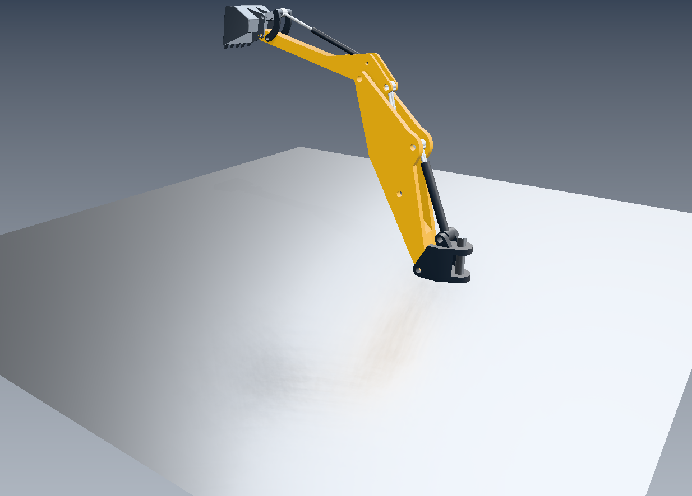

# C20: retained rough planar reflection, 2026-10-29

Branch `codex/coinrender-retained-integration`; pinned `codex/pbr-clean`
`ce72805f0536f8f0ef07dc5575d301b3ddffa507`. BGFX/Vulkan, native Xlib FreeCAD
viewport. [Source/binary/environment/CAD provenance](provenance.json).

The [smooth C19 control](smooth-control.png) has the same camera and exported
scene: the only scene-file difference is floor roughness .035 → .32.
[Reflection disabled](reflection-off.png) keeps the rough floor and all other
materials unchanged. [Default half-resolution](reflection-on.png),
[selection](selected.png) and [movement](moved.png) are also recorded.
The selected/moved part is `BucketLink2`; the C18 closed mesh repair remains active.
No CAD document was saved and no material override was written to the FCStd file.

## What is connected

The pinned **128-tap isotropic GGX shader is byte-identical**. It filters the
actual premultiplied reflected HDR image with linear sampling and leaves missing
sample coverage for environment fallback. CPU mapping adapts the original
power-of-two canonical coordinate system, camera and world-bounds proxy; retained
receiver slots replace source presentation flags. The Assembly proxy height is
284.032 authored units. It is a **finite depth approximation**, not ray tracing;
128 taps can show sampling structure, and CAD reflection error has no universal bound.

There is one main capture and semantic planner. Rough filtering consumes the
same C19 auxiliary view, VBO/IBO, draw order, shared IBL and world shadow map.
It creates no extra scene, capture, composition classifier, transport or reflection
image. Reflected-view SSAO remains disabled; main-view SSAO stays enabled.
The work remains on the application/Core-mapping/BGFX side, without native fork changes.

`CoinRenderPbrEffects::roughPlanarReflection` explicitly enables the profile.
Roughness ≤ .045 preserves the old point-sampled smooth path. Zero proxy height
uses the source's unfiltered fallback. Rough receivers require isotropic planar
unperturbed normals, scalar roughness, no ORM map and no clearcoat; physical CAD
body materials keep their previous normal-map/anisotropy/clearcoat support.
Non-similarity cameras, nonfinite bounds and insufficient budgets are refused.
Every draw resets its rough selector to avoid cross-target or physical-draw leakage.

## Validation

- [21 CTest regressions](tests.log): all passed; [XML](tests.xml),
  [detailed output](tests-detailed.log). Includes native defaults, material/IBL,
  anisotropy, effects, reflection, connector/no-borrow and BGFX core/instancing.
- [Independent smooth geometric oracle and rough GPU tests](reflection-test.log):
  1723 smooth pixels exactly equal; roughness .18/.32/.65 lights respectively
  2005/5075/10687 floor pixels outside the sharp silhouette. This proves visible
  broadening rather than just roughness-dependent intensity. Exact callback RGBA
  and unchanged physical depth at all three roughnesses; scaled controls, budget
  refusal/retry, anisotropic/coat refusal, smooth reset and scalar geometry reuse pass.
  Retained rough calls invoke zero additional composition classifications.
- [12 mapping comparisons against separately compiled pinned source](mapping-comparison.json):
  perspective/orthographic, tilted/offset planes and units 1e-5/1/1e5. Ten are
  bit-exact. The other two have maximum absolute error 1.1920928955078125e-7
  (scaled error 6.736997325681542e-8), from physical-plane reconstruction rounding.
  Tolerance is 2e-6 scaled; all pass. Nonfinite/non-similarity rejection preserves
  the prior mapping. [Pinned](pinned-mapping.txt) and [retained](retained-mapping.txt) values.
- [Nine AssemblyExample native GUI stages](results.json): on/off, quarter/full
  resolution, restoration, selection, movement, interaction restoration and static repaint.
- [20 exact independent offscreen RGBA/depth buffers](comparison.json).
  All nine native OS snapshots exactly match the offscreen controls in this run.
- [15 native reuse/admission/retirement checks](native-cache.json) with rough reflection enabled.
- [Contribution audit](boundary-audit.json): PASS; 203 classified paths,
  64 native-boundary paths. C20 is CoinRender-only.

[Recorded counters](counters.json): effect/resolution changes, selection and
movement keep **one capture, one plan, one transport, 184278 copied vertices**.
Combined interaction restoration conservatively recaptures once (cumulative two),
as in C19. Final static repaint increases reuse while reflection passes remain
seven and shaded frames remain eight. Environment upload and anisotropy preparation
remain one. Native pixel readbacks, Qt image bytes and legacy render calls are zero.
OS screenshots are test evidence, not production pixel transport.

## Resources and limits

No additional reflection texture is allocated relative to C19. At 1234×886,
RGBA16F + D24S8 attachments occupy 3279972 bytes (**3.13 MiB**) at the default
scale 2, 13119888 bytes (12.51 MiB) at scale 1, or 823176 bytes at scale 4.
The reflection budget additionally charges `2*sizeof(Mapping)+256` working bytes
for candidate/published CPU mapping and uniform storage. Replacement admission
also charges the resident framebuffer. Reflected draw metadata keeps its separate
16 MiB logical limit. These are resource footprints, not whole-process memory
measurements or a claim of FPS gains. The rough shader adds 128 samples per receiver
fragment on changed frames; static native HDR reuse bypasses that shading.

Local probes, stationary refinement, recursive/transparent reflection and wgpu/native
GL execution remain future work. This campaign connects the source's bounded rough
profile; it does not validate arbitrary real-CAD reflection accuracy.

## Reproduction

[Commands](commands.txt) use the qualified `/tmp/coin-retained-bgfx` build.
Run GPU jobs sequentially and use fresh output directories. `COIN_ASSEMBLY_ROUGH_REFLECTION_PREVIEW=1`
selects this fixed-camera preview. The optional `ROUGH 0|1` packet follows `REFL`;
older packets still work. [Scene](scene.iv.gz), [packets](requests.txt),
[frames](frames.jsonl) and [mesh reports](mesh-reports.json) preserve the input.
