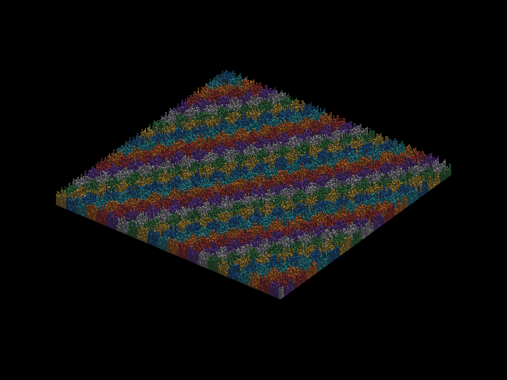
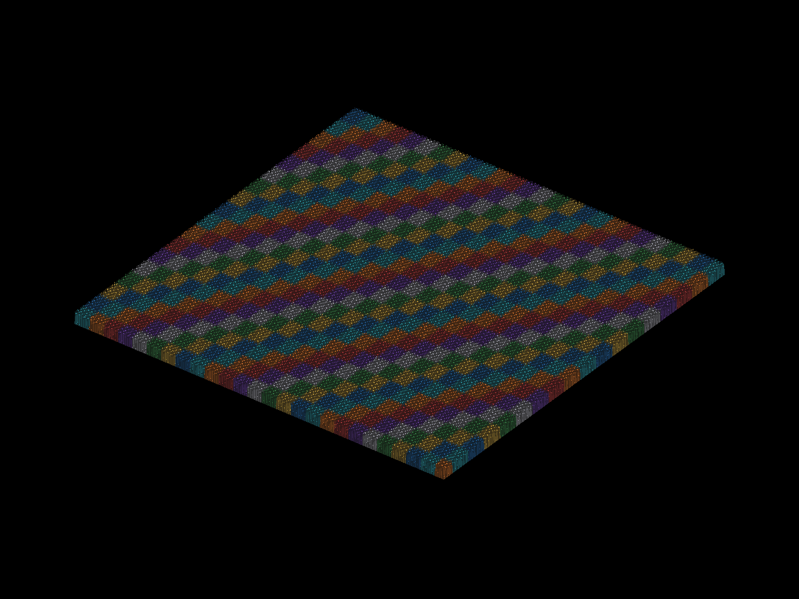
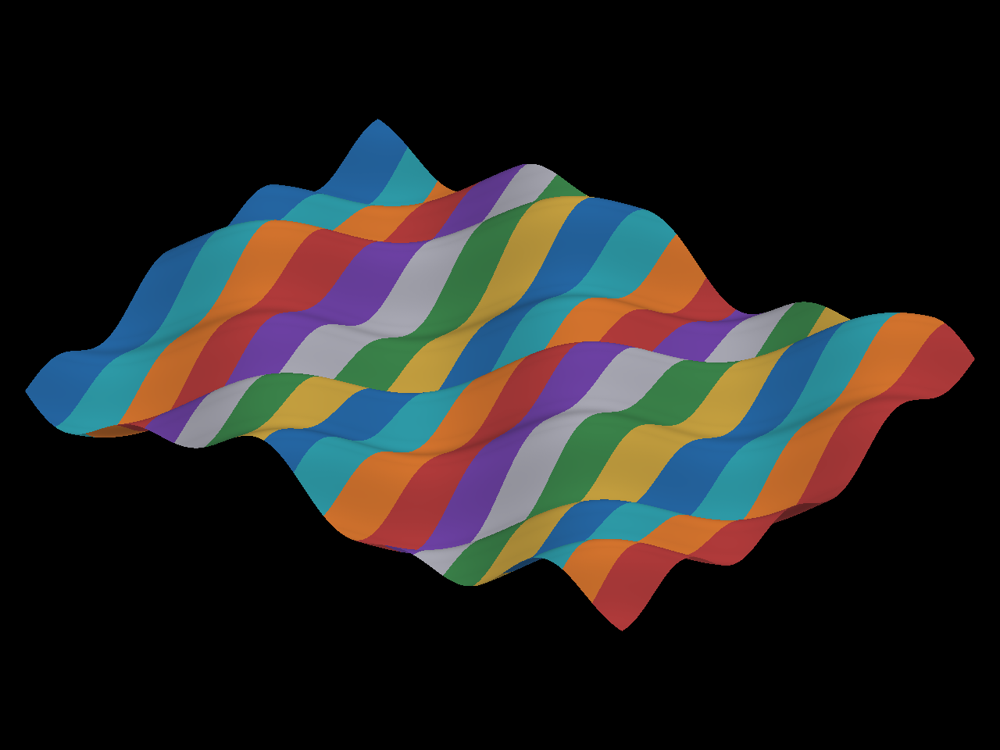
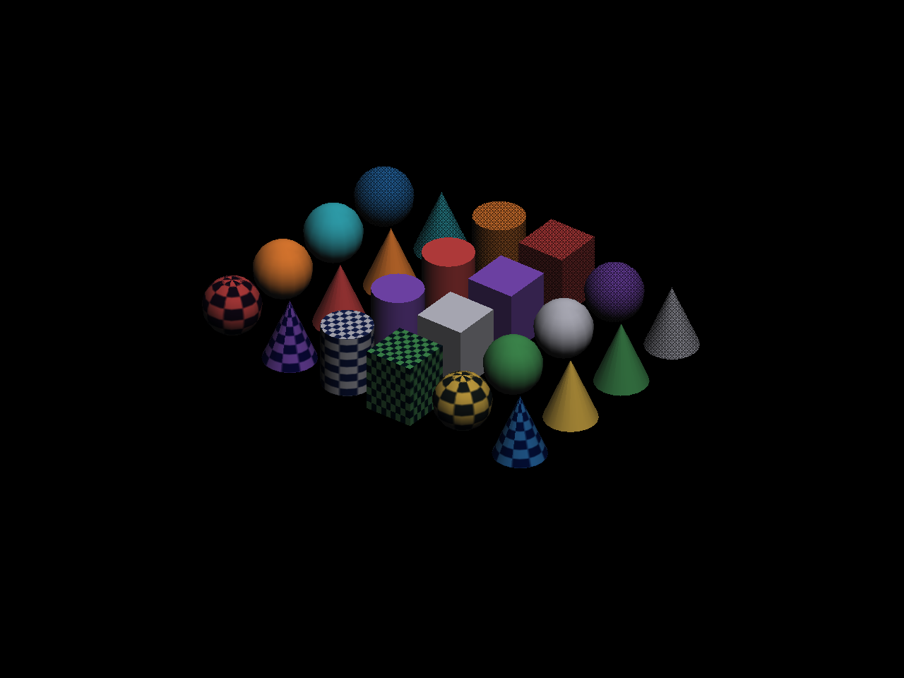

# Cenas visuais de CoinRender neste Linux — 2026-10-10

Continuação local da [campanha Windows](../../coin-render-windows-visual-scenes-20261010.md). O checkout isolado `codex/linux-windows-visual-20261010` parte exatamente de `e34181556eef346a38ec4776e93d39f84f61a7fc`, que contém as modificações e o relatório Windows. Compilei e instalei Coin/CoinRender BGFX e wgpu em prefixes separados de `build-linux-visual-20261010/` no workspace, e compilei um consumidor contra cada SDK instalado. O patch externo do SDK BGFX para perda de dispositivo D3D12 qualifica Windows; não foi necessário nem aplicável à rota Linux Vulkan/OpenGL desta rodada.

## Ambiente e critério

Linux x86_64, X11 `:0`, 1280×960. BGFX/Vulkan e wgpu/Vulkan selecionaram NVIDIA RTX 3060 Laptop (`10de:2560`, driver 615.71.09). BGFX/OpenGL usou AMD Radeon Graphics/renoir, Mesa 25.2.8, confirmado pelas strings do contexto GL corrente com `COIN_BGFX_TRACE_GL_ADAPTER=1`; o probe BGFX isolado informa vendor 0 antes da superfície. Wgpu/OpenGL selecionou a AMD (`1002`) com `WGPU_BACKEND=gl`. Todos os processos pediram a API explicitamente; `D3D12` é exclusivo do Windows e não entra no denominador Linux.

O `main.cpp` preserva as quatro cenas, dois perfis `native`/`portable`, câmera e resolução da campanha Windows. A campanha inicial da cidade de 40 mil usa height 140; o primeiro controle estático usa 155 e o controle estático ajustado usa 140. Cada processo faz um warmup e dois frames, com comparação janela/offscreen antes e depois: RGB máximo **0** e cobertura visível maior que 10%. Readback ocorre fora dos frames medidos. A janela Win32 e GDI foram substituídos por Xlib e `XGetImage` para wgpu/OpenGL. O oráculo verifica consistência entre superfícies da mesma API/política, não equivalência CoinGL independente nem desempenho ou latência de display.

## Resultado estrito

**16/48 processos PASS; 32/48 FAIL.** Cada célula agrega `native` e `portable` (`passes/2`); `i/f` é o RGB máximo nas capturas inicial/final. Todos os processos terminaram normalmente, exceto a rejeição de validação wgpu no terreno, convertida em status 7 pela ponte Rust.

| Campanha e cena | BGFX/Vulkan NVIDIA | BGFX/OpenGL AMD | wgpu/Vulkan NVIDIA | wgpu/OpenGL AMD |
|---|---:|---:|---:|---:|
| Inicial: cidade 40 mil, câmera móvel | 0/2 · 0/136 | 0/2 · 94/146 | 0/2 · 0/136 | 0/2 · 0/146¹ |
| Inicial: terreno, 1 milhão de triângulos | 0/2 · 0/1 | 0/2 · 123/3 | 0/2 · status 7 | 0/2 · status 7 |
| Inicial: 24 sólidos, textura/transparência | 2/2 · 0/0 | 0/2 · 1/7 native, 1/73 portable | 2/2 · 0/0 | 2/2 · 0/0 |
| Milhão de instâncias, câmera móvel | 0/2 · 0/112 | 0/2 · 135/146 | 0/2 · 0/118 | 0/2 · 0/146 |
| Cidade 40 mil, câmera fixa, height 155 | 2/2 · 0/0 | 2/2 · 0/0 | 2/2 · 0/0 | 0/2 · 208/0¹ |
| Cidade 40 mil, câmera fixa, height 140 | 2/2 · 0/0 | 0/2 · 94/94 | 2/2 · 0/0 | 0/2 · 208/0¹ |

¹ A primeira captura wgpu/OpenGL pode sair preta neste fixture X11, com cobertura zero. Nos quatro processos estáticos isso ocorreu nas duas políticas; a captura final foi exata. A repetição do controle estático voltou a produzir preto inicial. Uma repetição da cidade móvel também apresentou preto inicial, embora a primeira rodada tenha sido exata. Esperar 500 ms, aguardar o mapeamento da janela e fazer até nove submissões antes da captura não resolveram. Assim, os quatro controles estáticos continuam **FAIL no gate estrito**; a causa da primeira apresentação/captura X11 ainda não foi atribuída ao renderizador.

O terreno wgpu falhou nas duas APIs e políticas com `Coin Uncached Vertex Buffer` inválido, o mesmo diagnóstico registrado no Windows. As cidades móveis divergem após a rotação também neste Linux. O controle fixo delimita essa diferença sem explicar sua causa. A falha BGFX/OpenGL no controle height 140 (94/94) e o passe em height 155 (0/0) são específicos da combinação exercitada e não autorizam generalizar o perfil.

## Evidência e reprodução

`results-bgfx.json` e `results-wgpu.json` guardam o resultado por processo, incluindo API, política, GPU, código de saída e máximos. `pixel-manifest.json` contém SHA256 de cada PPM e a verificação independente de **88 estágios de captura, com zero divergências** entre pixels salvos e recibos do fixture. Os logs completos estão em `logs/`; os PPMs originais e CSVs permanecem no diretório local ignorado `build-linux-visual-20261010/results/` junto aos SDKs. Nenhum FAIL foi convertido em passe ou imagem substituta.

A máscara [da divergência da cidade após mover a câmera](images/city-40000-final-difference-mask.png) e o par [janela preta](images/wgpu-opengl-first-window.png) / [offscreen preenchido](images/wgpu-opengl-first-offscreen.png) documentam os dois tipos de falha de captura.

Para reconstruir, configure a revisão `e34181556e` com `COIN_BUILD_RENDER=ON`, `COIN_RENDER_BACKEND=BGFX` ou `RUST_BRIDGE`, `COIN_INSTALL_RENDER_EXPERIMENTAL=ON` e prefixo separado por backend. Compile o `CMakeLists.txt` deste diretório com `CMAKE_PREFIX_PATH` apontando para o prefixo correspondente. Execute `coin_linux_visual_campaign <vulkan|opengl> <native|portable> <city-40000|city-million|terrain-million|solids> 2 1 <prefixo-saida>`. Para wgpu, selecione `WGPU_BACKEND=vulkan` ou `gl`; para BGFX/OpenGL, use `COIN_BGFX_TRACE_GL_ADAPTER=1` e confira a GPU no contexto corrente. `COIN_VISUAL_STATIC_CAMERA=1` fixa a câmera; `COIN_VISUAL_CITY_HEIGHT_155=1` escolhe o primeiro controle estático.

No encerramento de BGFX/Vulkan, o fixture não chama `XCloseDisplay`: o benchmark Linux do projeto já documenta que o DSO Vulkan pode registrar um callback Xlib que fica obsoleto após a destruição do runtime BGFX. A conexão é recuperada pelo sistema operacional quando o processo termina. A tentativa inicial com `XCloseDisplay` produziu SIGSEGV apenas depois de todos os recibos; ela não foi contada na matriz final.
